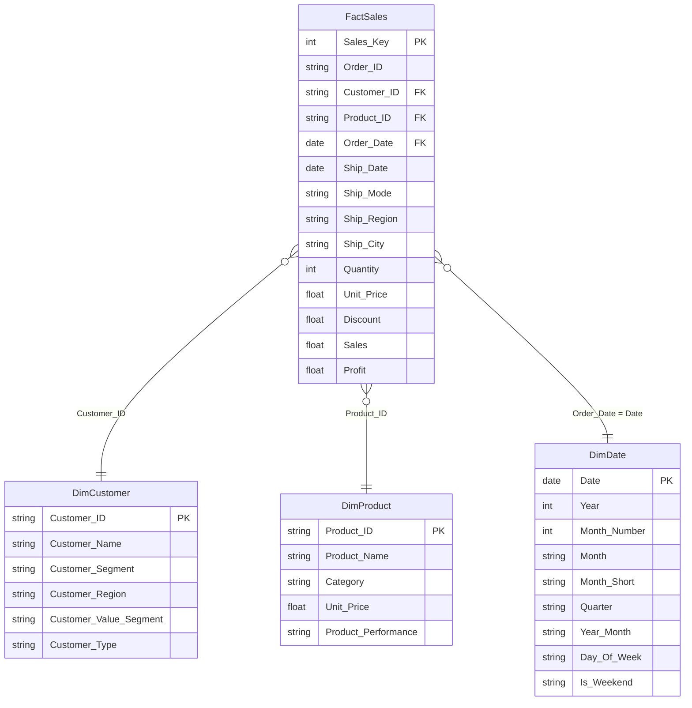
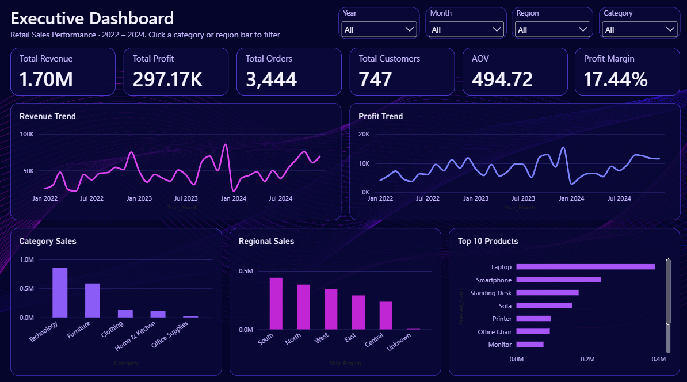
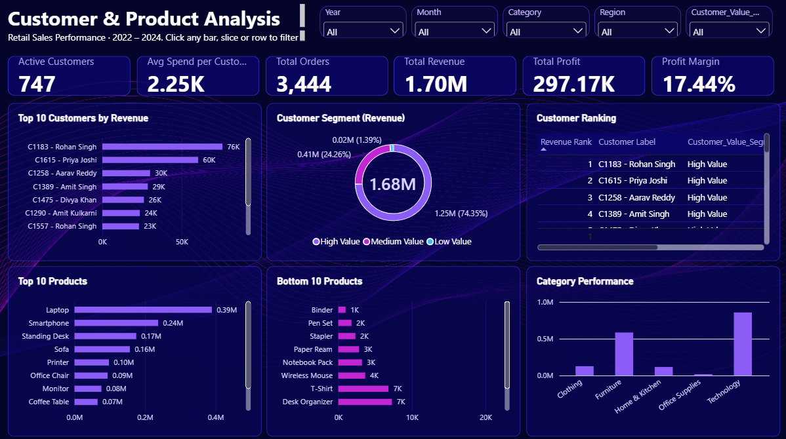
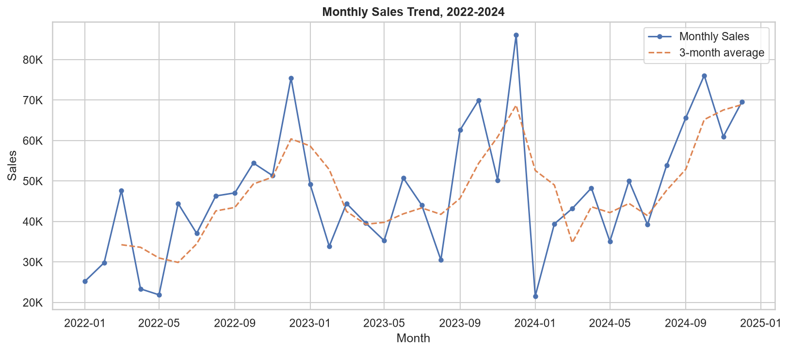
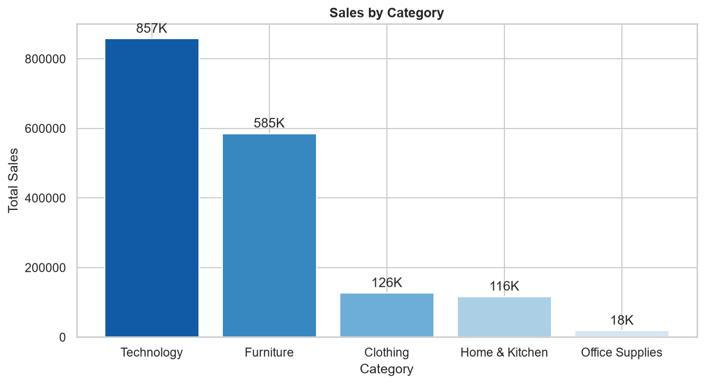
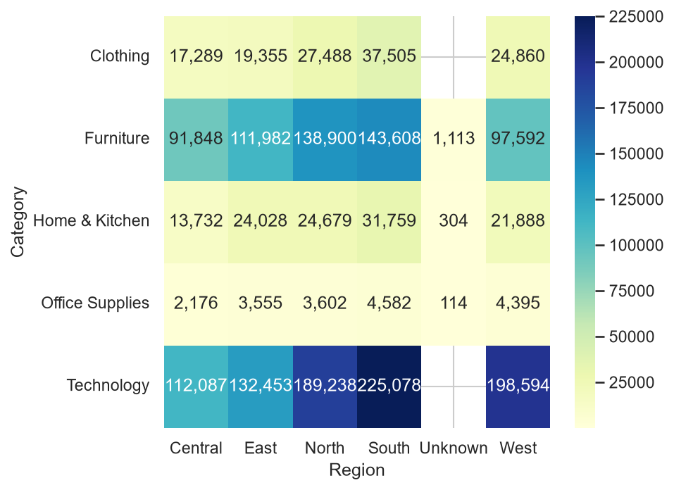

# Retail Sales Analysis

An end-to-end data analysis project on retail order data (2022–2024), built in Python. The notebook takes a messy raw CSV through cleaning, feature engineering, exploratory analysis, customer and product analysis, KPI calculation, and finally a star-schema data model that is ready to load into Power BI, Tableau, or a SQL database. That model then powers an interactive **Power BI dashboard** included in this repository.

## Table of Contents

- [Project Overview](#project-overview)
- [Tech Stack](#tech-stack)
- [Project Structure](#project-structure)
- [Dataset](#dataset)
- [Pipeline](#pipeline)
- [Data Model](#data-model)
- [Power BI Dashboard](#power-bi-dashboard)
- [Charts](#charts)
- [Key Insights](#key-insights)
- [How to Run](#how-to-run)

## Project Overview

| Stage | What it does | Output |
|---|---|---|
| 1. Data cleaning | Fixes duplicates, mixed date formats, wrong datatypes and missing values | `data/cleaned/Cleaned_Retail_Sales.csv` |
| 2. Feature engineering | Adds date features, margins, segments and categories | `data/transformed/Transformed_Retail_Sales.csv` |
| 3. Sales EDA | Sales trends, category, region, product and profit analysis | `outputs/charts/` |
| 4. Customer analysis | Top customers, repeat vs one-time, value segments | `outputs/charts/` |
| 5. Product analysis | Best and worst products, low-margin and declining products | `outputs/charts/` |
| 6. KPIs | Revenue, profit, orders, customers, AOV, margin, YoY growth | Printed in notebook |
| 7. Data model | Star schema with one fact table and three dimensions | `data/data_model/` |
| 8. Dashboard | Interactive Power BI report built on the data model | `dashboard/retail_sales_dashboard.pbix` |

## Tech Stack

- **Python 3.13**
- **pandas** and **numpy** for cleaning and transformation
- **matplotlib** and **seaborn** for visualization
- **Jupyter Notebook** (developed in VS Code)
- **Power BI Desktop** for the interactive dashboard

## Project Structure

```
retail-sales-analysis/
│
├── README.md
├── requirements.txt
├── .gitignore
│
├── data/
│   ├── raw/
│   │   └── retail_sales.csv
│   ├── cleaned/
│   │   └── Cleaned_Retail_Sales.csv
│   ├── transformed/
│   │   └── Transformed_Retail_Sales.csv
│   └── data_model/
│       ├── FactSales.csv
│       ├── DimCustomer.csv
│       ├── DimProduct.csv
│       └── DimDate.csv
│
├── notebooks/
│   └── retailCompanySalesAnalysis.ipynb
│
├── dashboard/
│   ├── retail_sales_dashboard.pbix
│   └── screenshots/
│       ├── executive_dashboard.png
│       └── customer_product.png
│
└── outputs/
    └── charts/
        └── *.png
```

The raw file is never overwritten. Each stage reads from the previous folder and writes to its own, so the flow is easy to follow: raw → cleaned → transformed → data model.

## Dataset

The raw file `retail_sales.csv` contains order line items with these columns:

| Group | Columns |
|---|---|
| Order | `Order_ID`, `Order_Date`, `Ship_Date`, `Ship_Mode` |
| Customer | `Customer_ID`, `Customer_Name`, `Segment` |
| Product | `Product_ID`, `Product_Name`, `Category`, `Unit_Price` |
| Location | `Region`, `City` |
| Measures | `Quantity`, `Discount`, `Sales`, `Profit` |

Period covered: **2022–2024**. Each row is one product line within an order.

## Pipeline

### 1. Data Cleaning

The raw data had several quality problems. These are the fixes applied, in order:

- **Exact duplicates** removed.
- **Text standardization**: `Category` and `Region` stripped and converted to title case, so variants like `" south"` and `"South"` merge. Duplicates are checked again afterwards.
- **Mixed date formats**: `Order_Date` and `Ship_Date` are parsed as `YYYY-MM-DD` first, then `DD/MM/YYYY` for anything that failed.
- **Datatypes**: `Sales`, `Profit`, `Unit_Price` and `Discount` converted to numeric; `Quantity` converted to nullable `Int64`.
- **Validation**: checks for non-positive sales, prices and quantities, and negative discounts.
- **Key-based duplicates**: rows sharing the same `Order_ID` + `Product_ID` are collapsed, keeping the row with the fewest missing values.
- **Estimated ship dates flagged**: a `Ship_Date_Estimated` column records which dates were filled in rather than observed.

**Missing value strategy**

| Column | How it was filled |
|---|---|
| `Product_Name`, `Category`, `Unit_Price` | Looked up from other rows with the same `Product_ID` |
| `Region` | Looked up from other rows in the same `City`, otherwise `Unknown` |
| `City` | `Unknown` |
| `Customer_Name`, `Segment` | Looked up from other rows with the same `Customer_ID`; names fall back to `Unknown`, segment to the most common value |
| `Customer_ID` | `Unknown` |
| `Ship_Mode` | Most common value |
| `Discount` | Inferred from `Sales / (Unit_Price × Quantity)` and snapped to the nearest allowed tier (0, 5, 10, 15, 20, 30%), then most common value as a fallback |
| `Quantity` | Derived from `Sales / (Unit_Price × (1 − Discount))`, then median as a fallback |
| `Sales` | Recalculated as `Unit_Price × Quantity × (1 − Discount)` |
| `Profit` | Median profit of the same `Category` |
| `Ship_Date` | `Order_Date` + 4 days (flagged in `Ship_Date_Estimated`) |

**Final checks** printed at the end of cleaning: row count, remaining missing values, exact duplicates, duplicate `Order_ID` + `Product_ID` pairs, rows where `Sales` differs from the formula by more than 4%, and number of estimated ship dates.

### 2. Feature Engineering

New columns added to create the transformed dataset:

| Feature | Description |
|---|---|
| `Year`, `Month`, `Month_Name`, `Quarter`, `Day_Of_Week` | Date parts from `Order_Date` |
| `Profit_Margin` | `Profit / Sales × 100` |
| `Margin_Outlier` | `Yes` when margin is above 100% |
| `Gross_Line_Value` | `Unit_Price × Quantity`, before discount |
| `Order_Value` | Total sales of all lines sharing an `Order_ID` |
| `Customer_Total_Spend` | Total sales per customer (blank for unknown customers) |
| `Customer_Value_Segment` | `High Value` (top 25% spenders), `Medium Value`, `Low Value` (bottom 25%), or `Unknown` |
| `Customer_Type` | `Repeat` (more than one order), `One-time`, or `Unknown` |
| `Sales_Category` | `Low`, `Medium` or `High Sales`, based on the 25th and 75th percentiles |
| `Profit_Category` | `Loss`, `Low Profit` (<10% margin), `Medium Profit` (<25%), `High Profit` |
| `Order_Size` | `Small` (1–2 units), `Medium` (3–5), `Large` (6+) |
| `Product_Performance` | `Top Performer`, `Average Performer` or `Under Performer`, based on total profit quartiles |
| `Days_To_Ship` | `Ship_Date − Order_Date` in days |
| `Discount_Applied` | `Yes` when discount is above 0 |

Customers with an unknown ID are excluded from the customer segmentation and customer analysis so they do not distort the results.

### 3. Sales EDA

- Total sales, total orders and average order value
- Year-over-year growth
- Monthly sales pattern (all years combined) and monthly trend with a 3-month moving average
- Sales by category, by region, and a category × region heatmap
- Top 10 and bottom 10 products by sales
- Profit and margin by category, region and product
- Sales distribution on a log scale with skewness

### 4. Customer Analysis

- Number of known customers, average vs median spend
- Top 10 and top 20 customers and their share of revenue
- Customer contribution to total revenue (top 10 vs everyone else)
- Repeat vs one-time customers
- Customer value segments: count of customers and share of revenue per segment

### 5. Product Analysis

- Product summary table: sales, profit, orders, units sold, margin and sales share
- Top 10 products by sales and by profit, bottom 10 by sales
- Loss-making products
- **High sales + low margin** products: top-quartile sales with margin below the overall margin
- **Declining products**: those that fell in both 2023 and 2024, and those that fell in 2024 after growing in 2023
- Category performance: sales vs profit and margin per category

### 6. KPIs

| KPI | Definition |
|---|---|
| Total Revenue | Sum of `Sales` |
| Total Profit | Sum of `Profit` |
| Total Orders | Distinct `Order_ID` |
| Total Customers | Distinct known `Customer_ID` |
| Average Order Value | Total revenue / total orders |
| Profit Margin | Total profit / total revenue × 100 |
| Yearly Growth | Year-over-year % change in sales |

## Data Model

The final step builds a **star schema** and exports each table as a CSV, ready for Power BI, Tableau or SQL.



**Grain of the fact table:** one row per `Order_ID` + `Product_ID`.

**Integrity checks** run before export (the notebook stops with an error if any fail):

- Primary keys are unique in every dimension
- Every foreign key in `FactSales` has a matching parent row
- No duplicate `Order_ID` + `Product_ID` pairs in the fact table
- Total sales in `FactSales` equal total sales in the source data, so nothing was lost

Unknown customers are kept in the model through a dedicated `Unknown` row in `DimCustomer`, so their sales still count in the totals.

## Power BI Dashboard

The file `dashboard/retail_sales_dashboard.pbix` is a Power BI report built on the star schema from the previous step (`FactSales`, `DimCustomer`, `DimProduct`, `DimDate`). Open it with **Power BI Desktop** (free, Windows).

### Page 1: Executive Dashboard

A high-level view of business performance.

- **KPI cards:** Total Revenue, Total Profit, Total Orders, Total Customers, Average Order Value (AOV), Profit Margin
- **Revenue Trend** and **Profit Trend** by month (line charts)
- **Category Sales**, **Regional Sales** and **Top 10 Products** (bar and column charts)
- **Slicers:** Year, Month, Category and Region



### Page 2: Customer & Product

A closer look at who is buying and what is selling.

- **KPI cards:** Total Revenue, Total Profit, Profit Margin, Total Orders, Active Customers, Average Spend per Customer
- **Top 10 Customers by Revenue** and a **Customer Ranking** table with revenue rank, revenue share % and segment
- **Customer Segment (Revenue)** donut chart
- **Top 10 Products**, **Bottom 10 Products** and **Category Performance**
- **Slicers:** Year, Month, Category, Region and Customer Value Segment



A hidden **Tooltip** page shows revenue, profit, orders and margin when you hover over a visual.

## Charts

All charts are saved to `outputs/charts/`.

| File | Chart |
|---|---|
| `01_monthly_sales_line.png` | Monthly sales, all years combined |
| `01b_monthly_sales_trend.png` | Monthly sales trend with 3-month average |
| `02_category_sales_bar.png` | Sales by category |
| `03_region_sales_bar.png` | Sales by region |
| `04_category_region_heatmap.png` | Sales by category and region |
| `05_top10_products.png` / `05b_bottom10_products.png` | Top and bottom 10 products by sales |
| `06_profit_by_category.png` | Profit and margin by category |
| `07_profit_by_region.png` | Profit and margin by region |
| `08_profit_by_product.png` | Top 10 products by profit |
| `09_sales_distribution.png` | Sales histogram and boxplot |
| `10_top10_customers.png` | Top 10 customers |
| `11_customer_contribution.png` | Top 10 customers vs all others |
| `12_segment_distribution.png` | Customer value segments |
| `13_repeat_vs_onetime.png` | Repeat vs one-time customers |
| `14_top10_products_sales.png` | Top 10 products by sales |
| `15_bottom10_products_sales.png` | Bottom 10 products by sales |
| `16_top10_products_profit.png` | Top 10 products by profit |
| `17_sales_vs_margin_scatter.png` | Sales vs margin, low-margin products highlighted |
| `18_declining_products.png` | Consistently declining products |
| `19_category_performance.png` | Category sales, profit and margin |

**Preview**







## Key Insights

- **Overall performance:** Total revenue of **1,703,803.93** at a profit margin of **17.44%**, across **3,444 orders** from **747 known customers**. Average order value was **494.72**.
- **Growth:** Sales grew **18.31%** in 2023, but growth slowed sharply to **1.07%** in 2024.
- **Seasonality:** Sales peak in **October and December** and are weakest in **January and May**.
- **Categories:** **Technology** is the largest category with **50.3%** of total sales. **Clothing** has the highest margin at **31.5%**, well above the overall margin of 17.44%.
- **Regions:** **South** leads with **26.0%** of sales, while **Central** contributes the least at **13.6%**.
- **Products:** The top 10 products generate **81.3%** of total sales, so revenue is highly concentrated. No product is loss-making, but **7 products** have high sales with below-average margin.
- **Declining products:** **2 products** fell in both 2023 and 2024.
- **Customers:** The top 10 customers contribute **19.71%** of revenue, so there is no heavy dependence on a few buyers. **554 of 747 customers (about 74%)** are repeat buyers, and High Value customers generate **74.3%** of revenue.

## How to Run

1. Clone the repository

   ```bash
   git clone https://github.com/yashshinde927/retail-sales-analysis.git
   cd retail-sales-analysis
   ```

2. Install the dependencies

   ```bash
   pip install -r requirements.txt
   ```

3. Open `notebooks/retailCompanySalesAnalysis.ipynb` in VS Code or Jupyter and choose **Run All**.

4. To explore the dashboard, open `dashboard/retail_sales_dashboard.pbix` in Power BI Desktop. If Power BI asks you to refresh or locate the data, point it to the CSV files in `data/data_model/`.

The notebook uses paths relative to its own folder (`../data/...`), so make sure the working directory is `notebooks/`. This is the default in VS Code. All output folders are created automatically if they do not exist.

## Author

**Yash Shinde**
[LinkedIn](https://www.linkedin.com/in/yash-shinde-092917311) · [GitHub](https://github.com/yashshinde927)
